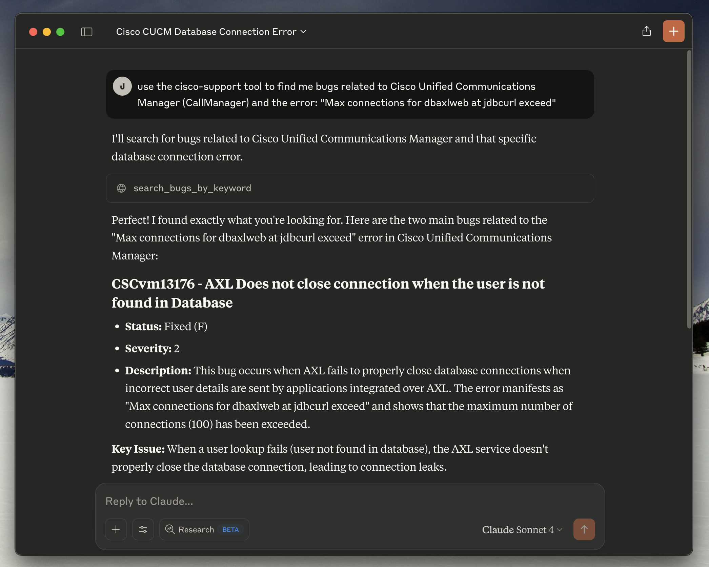
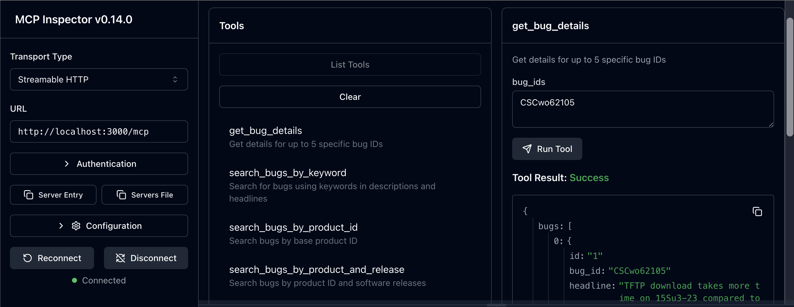

# Cisco Support MCP Server

[](https://www.npmjs.com/package/mcp-cisco-support)
[](https://opensource.org/licenses/MIT)
[](https://www.typescriptlang.org/)
[](https://modelcontextprotocol.io/)
[](https://glama.ai/mcp/servers/@sieteunoseis/mcp-cisco-support)
[](https://developer.cisco.com/codeexchange/github/repo/sieteunoseis/mcp-cisco-support)
[](https://ghcr.io/sieteunoseis/mcp-cisco-support)
[](https://github.com/sieteunoseis/mcp-cisco-support/actions)

A production-ready TypeScript MCP (Model Context Protocol) server for Cisco Support APIs with comprehensive security and dual transport support. This extensible server provides access to multiple Cisco Support APIs including Bug Search, Case Management, and End-of-Life information.

## 🚀 Current Features

- **Multi-API Support**: 8 Cisco Support APIs behind 12 tools
- **ElicitationRequest Support**: Dynamic user interaction for gathering missing parameters
- **Auth Modes**: stdio (no auth) and Bearer token (HTTP). OAuth via an external identity provider is planned ([#14](https://github.com/sieteunoseis/mcp-cisco-support/issues/14))
- **Configurable API Access**: Enable only the Cisco Support APIs you have access to
- **Specialized Prompts**: 9 workflow prompts for guided Cisco support scenarios
- **Dual Transport**: stdio (local MCP clients) and HTTP (remote server with auth)
- **OAuth2 Authentication**: Automatic token management with Cisco API
- **Streamable HTTP**: remote mode with bearer-token auth
- **TypeScript**: Full type safety and MCP SDK integration
- **Security**: Helmet, CORS, input validation
- **Docker Support**: Containerized deployment
- **Comprehensive Logging**: Structured logging with timestamps

## 📊 Tools (v3.0.0)

v3.0.0 replaced the 58 per-endpoint tools with 12 resource-oriented tools. Every tool is read-only, returns a concise result by default (`response_format: "detailed"` for more), and list tools return normalized `paging` (`total_records`, `next_page`). Endpoints and response fields were verified against the live Cisco APIs.

| Tool | API (`SUPPORT_API`) | What it does |
|------|---------------------|--------------|
| `bug_get` | `bug` | Bug details by ID (up to 5) |
| `bug_search` | `bug` | Bugs by keyword, product ID, product series or product name; releases affected or fixed; several severities in one call |
| `assess_upgrade` | `bug` (+ `psirt`, `software`, `eox` when enabled) | Current vs target release: open bugs, bugs the target fixes, advisories fixed/remaining/new, end-of-life. Defaults to Cisco's suggested release |
| `psirt_get` | `psirt` | Security advisory by advisory ID, CVE or bug ID |
| `psirt_search` | `psirt` | Advisories affecting an OS release (`os_type` + `version`), or by product, severity, year, latest, date range |
| `eox_get` | `eox` | End-of-sale / end-of-support by product IDs, serials, software releases or announcement dates |
| `device_lookup` | `serial`, `product`, `eox` | Per serial number: contract coverage and warranty, product details and EoX, in one call |
| `product_get` | `product` | Product name, series, category, support page; optional MDF names |
| `software_get` | `software` | Cisco-suggested releases, latest releases, or releases compatible with a product |
| `case_get` | `case` | TAC cases by number; `detailed` adds notes and owner |
| `case_search` | `case` | TAC cases by contract or user ID |
| `rma_get` | `rma` | An RMA by number, or RMAs for a user ID |

**Configuration examples:**
- `SUPPORT_API=bug` (default): `bug_get`, `bug_search`, `assess_upgrade`
- `SUPPORT_API=bug,psirt,software,eox`: adds security and lifecycle data to `assess_upgrade`
- `SUPPORT_API=all`: all 12 tools

**Upgrading from 2.x:** calling an old tool name returns an error naming its replacement (e.g. `search_bugs_by_keyword` → `bug_search`). The `enhanced_analysis`, `sampling` and `smart_bonding` options were removed.

## Quick Start

### NPX Installation (Recommended)

**Start in stdio mode for Claude Desktop:**
```bash
npx mcp-cisco-support
```

**Start HTTP server with authentication:**
```bash
npx mcp-cisco-support --http
# Token displayed in console for authentication
```

**Generate Bearer token for HTTP mode:**
```bash
npx mcp-cisco-support --generate-token
```

**Get help and see all options:**
```bash
npx mcp-cisco-support --help
```

### Environment Setup

1. **Generate authentication token (for HTTP mode):**
   ```bash
   npx mcp-cisco-support --generate-token
   export MCP_BEARER_TOKEN=<generated_token>
   ```

2. **Set Cisco API credentials:**
   ```bash
   export CISCO_CLIENT_ID=your_client_id_here
   export CISCO_CLIENT_SECRET=your_client_secret_here
   export SUPPORT_API=bug,case,eox,psirt,product,software  # All implemented APIs (recommended)
   ```

3. **Start the server:**
   ```bash
   # For Claude Desktop (stdio mode)
   npx mcp-cisco-support
   
   # For HTTP access (with authentication)
   npx mcp-cisco-support --http
   ```

### Local Development
```bash
git clone https://github.com/sieteunoseis/mcp-cisco-support.git
cd mcp-cisco-support
npm install
npm run build
npm start
```

## Claude Desktop Integration

### Prerequisites

1. **Get Cisco API Credentials**:
   - Visit [Cisco API Console](https://apiconsole.cisco.com/)
   - Create an application and get your Client ID and Secret
   - Ensure the application has access to the Bug API

2. **Install Claude Desktop**:
   - Download from [Claude.ai](https://claude.ai/download)
   - Make sure you're using a recent version that supports MCP

### Step-by-Step Setup

1. **Locate Claude Desktop Config File**:
   - **macOS**: `~/Library/Application Support/Claude/claude_desktop_config.json`
   - **Windows**: `%APPDATA%\Claude\claude_desktop_config.json`

2. **Create or Edit the Config File**:
   ```json
   {
     "mcpServers": {
       "cisco-support": {
         "command": "npx",
         "args": ["-y", "mcp-cisco-support"],
         "env": {
           "CISCO_CLIENT_ID": "your_client_id_here",
           "CISCO_CLIENT_SECRET": "your_client_secret_here",
           "SUPPORT_API": "bug,product"
         }
       }
     }
   }
   ```

   > **Note:** The `-y` flag automatically accepts package installation, which is required for Claude Desktop since it runs in the background without user interaction.

   **Optional Environment Variables:**

   Configure which APIs to enable with `SUPPORT_API`:
   - `"bug"` - Bug API only (default)
   - `"bug,psirt,software,eox"` - Bug tools plus security and lifecycle data for `assess_upgrade`
   - `"all"` - All available APIs
   - `"bug,case,eox"` - Multiple specific APIs

3. **Replace Your Credentials**:
   - Replace `your_client_id_here` with your actual Cisco Client ID
   - Replace `your_client_secret_here` with your actual Cisco Client Secret

4. **Restart Claude Desktop**:
   - Close Claude Desktop completely
   - Reopen the application
   - The MCP server will be automatically loaded

### Verification

After setup, you should be able to:

1. **Ask Claude about Cisco bugs**:
   ```
   "Search for bugs related to memory leaks in Cisco switches"
   ```

2. **Get specific bug details**:
   ```
   "Get details for Cisco bug CSCab12345"
   ```

3. **Search by product**:
   ```
   "Find bugs affecting Cisco Catalyst 3560 switches"
   ```

### Example Usage in Claude Desktop

Once configured, you can ask Claude questions like:

- **Basic Bug Search**:
  - "Search for recent bugs related to 'crash' in Cisco products"
  - "Find open bugs with severity 1 or 2"
  - "Show me bugs modified in the last 30 days"

- **Product-Specific Searches**:
  - "Find bugs for product ID C9200-24P"
  - "Search for bugs in Cisco Catalyst 9200 Series affecting release 17.5.1"
  - "Show bugs fixed in software release 17.5.2"

- **Bug Details**:
  - "Get full details for bug CSCab12345"
  - "Show me information about bugs CSCab12345,CSCcd67890"

- **Advanced Filtering**:
  - "Find resolved bugs with severity 3 modified after 2023-01-01"
  - "Search for bugs in 'Cisco ASR 9000 Series' sorted by severity"
  - "Can you show me all the cisco bugs in the last 30 days for the product Cisco Unified Communications Manager (CallManager)?" (uses keyword search)
  - "Find bugs for Cisco Unified Communications Manager affecting releases 14.0 and 15.0" (uses product series search)

Claude will use the appropriate MCP tools to fetch real-time data from Cisco's Bug API and provide comprehensive responses with the latest information.

## MCP Prompts

The server includes **10+ specialized prompts** for guided Cisco support workflows:

- **🔍 cisco-high-severity-search** - Search high-severity bugs by product or serial number
- **🚨 cisco-incident-investigation** - Investigate symptoms and errors
- **🔄 cisco-upgrade-planning** - Research issues before upgrades
- **🔧 cisco-maintenance-prep** - Prepare for maintenance windows
- **🔒 cisco-security-advisory** - Research security vulnerabilities
- **⚠️ cisco-known-issues** - Check for software release issues
- **📋 cisco-case-investigation** - Investigate support cases
- **⏰ cisco-lifecycle-planning** - End-of-life planning
- **🎯 cisco-smart-search** - Intelligent search with automatic refinement
- **✨ cisco-interactive-search** - Interactive search with elicitation

**Serial Number Support:** Most prompts now accept either a **product name** OR a **serial number**. When you provide a serial number (e.g., "SAL09232Q0Z"), the server automatically looks up the product details and uses them for the search. This makes it easy to investigate issues when you have a device serial number but don't know the exact product model.

Each prompt provides structured investigation plans and expert recommendations.

### Interactive Search with Elicitation

The **cisco-interactive-search** prompt demonstrates MCP's elicitation feature, allowing the server to dynamically request additional information from users during tool execution. This makes searches more natural and helps gather missing parameters without restarting requests.

**Example Usage:**
```
Use the "cisco-interactive-search" prompt with:
- initial_query: "memory leak"
- use_elicitation: true
```

See **[examples/elicitation-example.md](examples/elicitation-example.md)** for detailed usage examples and **[⚡ MCP Prompts](https://github.com/sieteunoseis/mcp-cisco-support/wiki/MCP-Prompts)** for complete prompt documentation.

## 🔍 MCP Resources

Resources are read-only views over the same tools, for clients that let you attach context:

| URI | Requires | Returns |
|-----|----------|---------|
| `cisco://bugs/{bug_id}` | `bug` | `bug_get` output |
| `cisco://products/{product_id}` | `product` | `product_get` output |
| `cisco://security/advisories/{advisory_id}` | `psirt` | `psirt_get` output |
| `cisco://security/cve/{cve_id}` | `psirt` | `psirt_get` output |
| `cisco://security/advisories/recent` | `psirt` | 20 most recent advisories |
| `cisco://security/advisories/critical` | `psirt` | Most recent critical advisories |

v3.0.0 removed the cookie-based product autocomplete resource and the "recent bugs" resources.

## Screenshots

### Claude Desktop Integration


*Claude Desktop successfully connected to the Cisco Support MCP server, demonstrating the bug search functionality with real-time responses from Cisco's Bug API.*

### MCP Inspector


*MCP Inspector v0.14.0+ showing the available tools and server connectivity testing capabilities.*

### Alternative Installation Methods

#### Global Installation
If you prefer to install globally instead of using npx:

```bash
npm install -g mcp-cisco-support
```

Then use this config:
```json
{
  "mcpServers": {
    "cisco-support": {
      "command": "mcp-cisco-support",
      "env": {
        "CISCO_CLIENT_ID": "your_client_id_here",
        "CISCO_CLIENT_SECRET": "your_client_secret_here",
        "SUPPORT_API": "bug"
      }
    }
  }
}
```

#### Local Installation
For development or custom setups:

```bash
git clone https://github.com/sieteunoseis/mcp-cisco-support.git
cd mcp-cisco-support
npm install
npm run build
```

Then use this config:
```json
{
  "mcpServers": {
    "cisco-support": {
      "command": "node",
      "args": ["/path/to/mcp-cisco-support/dist/index.js"],
      "env": {
        "CISCO_CLIENT_ID": "your_client_id_here",
        "CISCO_CLIENT_SECRET": "your_client_secret_here",
        "SUPPORT_API": "bug"
      }
    }
  }
}
```

### Troubleshooting

#### Common Issues

1. **"Command not found" errors**:
   - Ensure Node.js 18+ is installed
   - Try global installation: `npm install -g mcp-cisco-support`
   - Verify the path in your config file

2. **Authentication failures**:
   - Double-check your Client ID and Secret
   - Ensure your Cisco API app has Bug API access
   - Check for typos in the config file

3. **MCP server not loading**:
   - Restart Claude Desktop completely
   - Check the config file syntax with a JSON validator
   - Look for Claude Desktop logs/error messages

4. **Permission errors**:
   - Ensure the config file is readable
   - On macOS/Linux, check file permissions: `chmod 644 claude_desktop_config.json`

#### Debugging

1. **Test the server manually**:
   ```bash
   npx mcp-cisco-support
   ```
   This should start the server in stdio mode without errors.

2. **Validate your config**:
   Use a JSON validator to ensure your config file is properly formatted.

3. **Check Claude Desktop logs**:
   - Look for MCP-related error messages in Claude Desktop
   - The app usually shows connection status for MCP servers
   
   **Monitor logs in real-time (macOS)**:
   ```bash
   # Follow logs in real-time
   tail -n 20 -F ~/Library/Logs/Claude/mcp*.log
   ```
   
   **On Windows**:
   ```cmd
   # Check logs directory
   %APPDATA%\Claude\logs\
   ```

#### Getting Help

- **Issues**: [GitHub Issues](https://github.com/sieteunoseis/mcp-cisco-support/issues)
- **Cisco API**: [Cisco Developer Documentation](https://developer.cisco.com/docs/support-apis/)
- **MCP Protocol**: [Model Context Protocol](https://modelcontextprotocol.io/)

### Docker Deployment

```bash
# Use pre-built image
docker pull ghcr.io/sieteunoseis/mcp-cisco-support:latest
docker run -p 3000:3000 \
  -e CISCO_CLIENT_ID=your_id \
  -e CISCO_CLIENT_SECRET=your_secret \
  -e SUPPORT_API=bug \
  ghcr.io/sieteunoseis/mcp-cisco-support:latest --http

# Or build locally
docker-compose up -d
```

## 🔐 Security

- **stdio mode**: No authentication (Claude Desktop, local clients)
- **HTTP mode**: Bearer token authentication required

```bash
# Generate secure token
npx mcp-cisco-support --generate-token

# Use token for HTTP mode
export MCP_BEARER_TOKEN=your_token
npx mcp-cisco-support --http
```

See **[🔒 Security Guide](https://github.com/sieteunoseis/mcp-cisco-support/wiki/Security-Guide)** for complete security documentation.

## Configuration

### Environment Variables

Create a `.env` file with your configuration:

```bash
# 🔑 Cisco API OAuth2 Configuration (REQUIRED)
CISCO_CLIENT_ID=your_client_id_here
CISCO_CLIENT_SECRET=your_client_secret_here

# 🌐 Server Configuration
PORT=3000
NODE_ENV=development

# 🚀 API Support Configuration
# Enable specific Cisco Support APIs you have access to
# Options: bug, case, eox (plus planned: product, serial, rma, software, asd)
SUPPORT_API=bug,case,eox              # Multiple APIs
# SUPPORT_API=all                     # All available APIs  
# SUPPORT_API=bug                     # Single API (default)

# 🔐 HTTP Authentication Configuration (HTTP mode only)
# Custom Bearer token for HTTP authentication (optional - generates random if not set)
MCP_BEARER_TOKEN=your_custom_secure_token_here

# ⚠️ SECURITY WARNING: Only use in development/testing
# DANGEROUSLY_OMIT_AUTH=true          # Disables HTTP authentication entirely
```

### OAuth 2.1 (removed in v2.0.0)

The built-in OAuth 2.1 authorization server was removed in v2.0.0. Use bearer-token auth, or put the server behind a reverse proxy that handles sign-in. Support for validating tokens from an external identity provider (Authelia, Kong) is tracked in [#14](https://github.com/sieteunoseis/mcp-cisco-support/issues/14).

### Claude Desktop Integration

**Complete configuration for Claude Desktop:**
```json
{
  "mcpServers": {
    "cisco-support": {
      "command": "npx",
      "args": ["-y", "mcp-cisco-support"],
      "env": {
        "CISCO_CLIENT_ID": "your_client_id_here",
        "CISCO_CLIENT_SECRET": "your_client_secret_here",
        "SUPPORT_API": "bug,case,eox"
      }
    }
  }
}
```

### Docker Configuration

**Option 1: Bearer Token Authentication**
```bash
docker run -p 3000:3000 \
  -e CISCO_CLIENT_ID=your_client_id \
  -e CISCO_CLIENT_SECRET=your_client_secret \
  -e SUPPORT_API=bug,case,eox \
  -e MCP_BEARER_TOKEN=your_secure_token \
  ghcr.io/sieteunoseis/mcp-cisco-support:latest --http
```

**Option 2: Without Authentication (Development Only)**
```bash
docker run -p 3000:3000 \
  -e CISCO_CLIENT_ID=your_client_id \
  -e CISCO_CLIENT_SECRET=your_client_secret \
  -e DANGEROUSLY_OMIT_AUTH=true \
  ghcr.io/sieteunoseis/mcp-cisco-support:latest --http
```


## HTTP Endpoints (`--http`)

| Endpoint | Method | Description |
|----------|--------|-------------|
| `/mcp` | POST/GET/DELETE | MCP Streamable HTTP (requires `Authorization: Bearer <token>`) |
| `/health` | GET | Health check (no auth) |
| `/` | GET | Server information (no auth) |

The legacy HTTP+SSE transport (`/sse`, `/messages`) was removed in v3.0.0; use Streamable HTTP at `/mcp`.

## 📚 Documentation

For detailed information, see our comprehensive [GitHub Wiki](https://github.com/sieteunoseis/mcp-cisco-support/wiki):

- **[📋 Available Tools](https://github.com/sieteunoseis/mcp-cisco-support/wiki/Available-Tools)** - Complete reference for all 46 MCP tools across 8 APIs
- **[🔧 Advanced Configuration](https://github.com/sieteunoseis/mcp-cisco-support/wiki/Advanced-Configuration)** - Environment variables and deployment options
- **[🔒 Security Guide](https://github.com/sieteunoseis/mcp-cisco-support/wiki/Security-Guide)** - Authentication, tokens, and security best practices  
- **[🚀 Docker Deployment](https://github.com/sieteunoseis/mcp-cisco-support/wiki/Docker-Deployment)** - Containerized deployment and production setup
- **[🧪 Testing Framework](https://github.com/sieteunoseis/mcp-cisco-support/wiki/Testing-Framework)** - Comprehensive testing and validation
- **[🔧 Development Guide](https://github.com/sieteunoseis/mcp-cisco-support/wiki/Development-Guide)** - Contributing, architecture, and API development
- **[🚨 Troubleshooting Guide](https://github.com/sieteunoseis/mcp-cisco-support/wiki/Troubleshooting-Guide)** - Common issues and debugging
- **[⚡ MCP Prompts](https://github.com/sieteunoseis/mcp-cisco-support/wiki/MCP-Prompts)** - Guided workflows for Cisco support scenarios

## Usage Examples

### cURL Examples

Streamable HTTP needs an `initialize` request first; the response carries an `Mcp-Session-Id` header to send on later requests.

```bash
TOKEN=your_bearer_token
H=(-H "Authorization: Bearer $TOKEN" -H "Content-Type: application/json" -H "Accept: application/json, text/event-stream")

# Health (no auth)
curl http://localhost:3000/health

# Initialize and capture the session ID
SID=$(curl -s -D - -o /dev/null "${H[@]}" -X POST http://localhost:3000/mcp \
  -d '{"jsonrpc":"2.0","id":1,"method":"initialize","params":{"protocolVersion":"2025-11-25","capabilities":{},"clientInfo":{"name":"curl","version":"1"}}}' \
  | grep -i '^mcp-session-id' | awk '{print $2}' | tr -d '\r')
curl -s "${H[@]}" -H "mcp-session-id: $SID" -X POST http://localhost:3000/mcp -d '{"jsonrpc":"2.0","method":"notifications/initialized"}'

# List tools
curl -s "${H[@]}" -H "mcp-session-id: $SID" -X POST http://localhost:3000/mcp -d '{"jsonrpc":"2.0","id":2,"method":"tools/list"}'

# Call a tool
curl -s "${H[@]}" -H "mcp-session-id: $SID" -X POST http://localhost:3000/mcp \
  -d '{"jsonrpc":"2.0","id":3,"method":"tools/call","params":{"name":"bug_search","arguments":{"keyword":"crash","severity":["1","2"],"status":"O"}}}'
```

## Development and Testing

```bash
npm ci
npx tsc --noEmit     # type check
npm test             # unit + protocol tests (Cisco responses served from tests/fixtures/cisco)
npm run build
npm run dev          # stdio, auto-reload
npm run dev:http     # HTTP on 127.0.0.1:3000, auto-reload
```

Integration tests against the live Cisco APIs are opt-in: `RUN_INTEGRATION=1 CISCO_CLIENT_ID=... CISCO_CLIENT_SECRET=... npm test`.

See [CLAUDE.md](CLAUDE.md) for the code layout, Cisco API behaviour verified against the live APIs, how to record fixtures, and the release process.

## License

MIT License - see [LICENSE](LICENSE) file for details.

## Contributing

1. Fork the repository
2. Create a feature branch
3. Make your changes
4. Add tests for new functionality
5. Ensure all tests pass: `npm test`
6. Submit a pull request

## Support

### Resources

- **[📖 Complete Documentation](./CLAUDE.md)** - Comprehensive project documentation
- **[📚 Wiki](https://github.com/sieteunoseis/mcp-cisco-support/wiki)** - Detailed guides and troubleshooting
- **[🐛 Issues](https://github.com/sieteunoseis/mcp-cisco-support/issues)** - Report bugs and request features

### External Resources

- **[🔧 Cisco Developer Documentation](https://developer.cisco.com/docs/support-apis/introduction-to-cisco-support-apis/)** - Official API documentation
- **[🔒 Cisco PSIRT Documentation](https://developer.cisco.com/docs/psirt/)** - Security vulnerability API documentation
- **[💬 Cisco Services Discussions](https://community.cisco.com/t5/services-discussions/bd-p/j-disc-dev-services)** - Community support and API discussions
- **[🌐 MCP Protocol](https://modelcontextprotocol.io/)** - Model Context Protocol specification