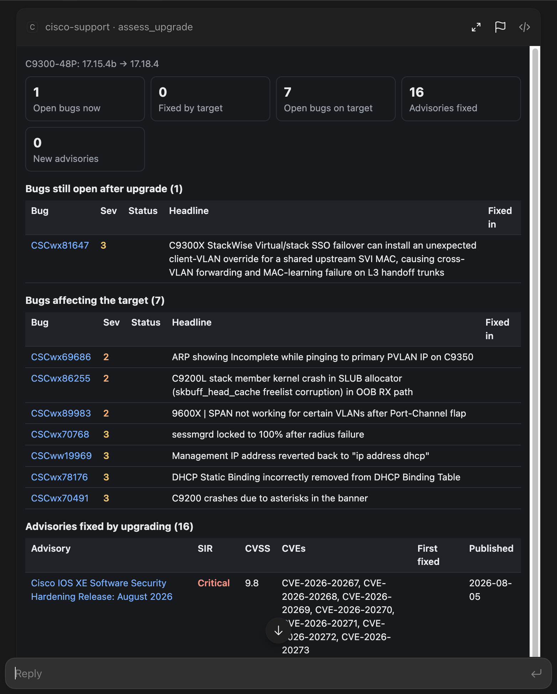
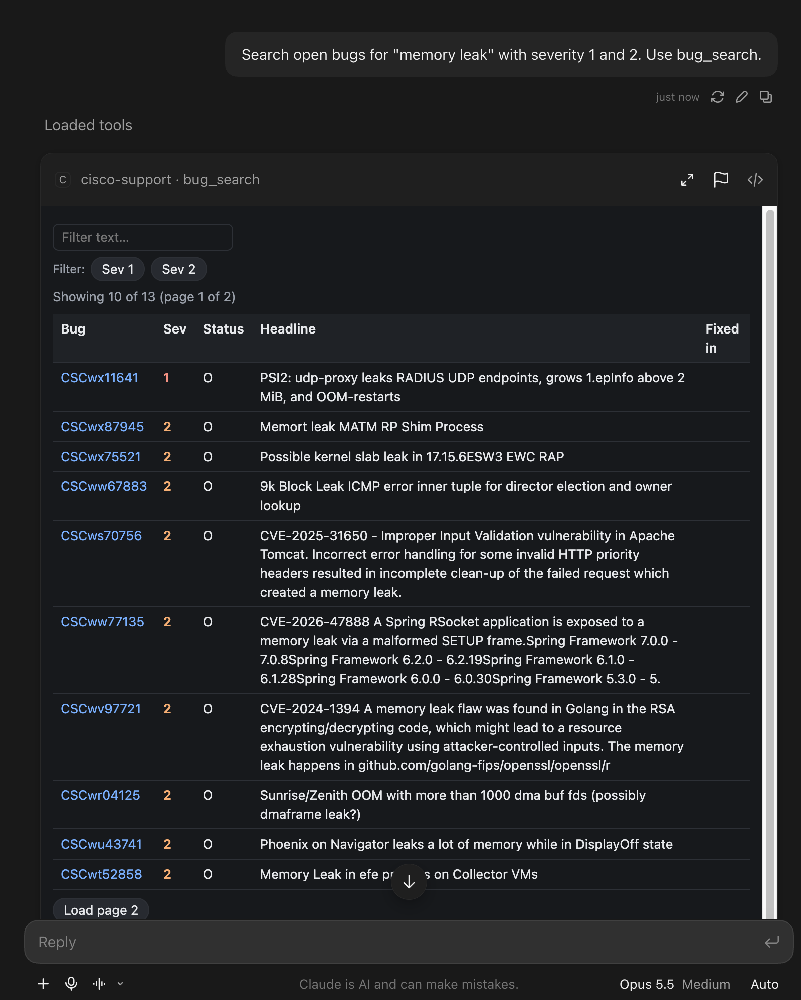

# Cisco Support MCP Server

[](https://www.npmjs.com/package/mcp-cisco-support)
[](https://opensource.org/licenses/MIT)
[](https://modelcontextprotocol.io/specification/2026-07-28)
[](https://glama.ai/mcp/servers/@sieteunoseis/mcp-cisco-support)
[](https://developer.cisco.com/codeexchange/github/repo/sieteunoseis/mcp-cisco-support)
[](https://ghcr.io/sieteunoseis/mcp-cisco-support)
[](https://github.com/sieteunoseis/mcp-cisco-support/actions)
[](https://skills.sh/sieteunoseis/mcp-cisco-support)

MCP server for the [Cisco Support APIs](https://developer.cisco.com/docs/support-apis/): bugs, security advisories (PSIRT), end-of-life (EoX), serial-number coverage, product info, software suggestions, TAC cases and RMAs.

- **12 read-only tools**, concise output by default, normalized paging, recorded against the live Cisco APIs
- **6 workflow prompts** and `cisco://` resources
- **MCP Apps view**: interactive tables in clients that support it (Claude, MCPJam, VS Code, …); plain text elsewhere
- **MCP 2026-07-28** (TypeScript SDK v2), and 2025-era clients too
- **stdio** for local clients, **stateless Streamable HTTP** (`--http`) with bearer-token auth and rate limiting for remote use
- npm (with provenance) and Docker (`linux/amd64`, `linux/arm64`)

> **Upgrading from 2.x?** Tool names changed and several features were removed. See [Upgrading to 3.0](https://github.com/sieteunoseis/mcp-cisco-support/wiki/Upgrading-to-3.0).

## Quick start

1. Create an app on the [Cisco API Console](https://apiconsole.cisco.com/) and note its client ID and secret. Request access to each Cisco API you want (Bug, PSIRT, EoX, Serial Number to Information, Product Information, Software Suggestion, Case, RMA).
2. Add the server to your MCP client. Claude Desktop (`claude_desktop_config.json`):

   ```json
   {
     "mcpServers": {
       "cisco-support": {
         "command": "npx",
         "args": ["-y", "mcp-cisco-support"],
         "env": {
           "CISCO_CLIENT_ID": "your_client_id",
           "CISCO_CLIENT_SECRET": "your_client_secret"
         }
       }
     }
   }
   ```

   Config file: `~/Library/Application Support/Claude/claude_desktop_config.json` (macOS), `%APPDATA%\Claude\claude_desktop_config.json` (Windows). Restart the client after editing.

3. Ask things like:
   - "Which security advisories affect IOS XE 17.9.4, and what's the first fixed release?"
   - "Should I upgrade my C9300-48P from 17.15.4b? Compare with Cisco's suggested release."
   - "Check coverage and end-of-life for serials FJC29161RHS, FJC29161H2U."
   - "Open severity 1–2 bugs mentioning memory leak."

Requires Node.js 20+.

## Tools

| Tool | What it does |
|------|--------------|
| `bug_get` | Bug details by ID (up to 5) |
| `bug_search` | Bugs by keyword, product ID, product series or product name; releases affected or fixed; several severities in one call |
| `assess_upgrade` | Current vs target release: open bugs on each, bugs the target fixes, advisories fixed / remaining / new, end-of-life. Defaults to Cisco's suggested release |
| `psirt_get` | Security advisory by advisory ID, CVE or bug ID |
| `psirt_search` | Advisories affecting an OS release (`os_type` + `version`), or by product, severity, year, latest, date range |
| `eox_get` | End-of-sale / end-of-support by product IDs, serials, software releases or announcement dates |
| `device_lookup` | Per serial number: contract coverage and warranty, product details and EoX |
| `product_get` | Product name, series, category, support page; optional MDF names |
| `software_get` | Cisco-suggested, latest, or compatible releases for a product |
| `case_get` | TAC cases by number (`detailed` adds notes and owner) |
| `case_search` | TAC cases by contract or user ID |
| `rma_get` | An RMA by number, or RMAs for a user ID |

**Exact releases:** if you give a partial release ("17", "17.9") where Cisco needs an exact one (`psirt_search`, `assess_upgrade`), the server asks you to pick, first the train and then the release, using Cisco's list of known releases. For `bug_search` (with `os_type`) a train is valid, so it offers the exact releases and lets you keep the train. Clients without elicitation support get the candidates in the result, and the model asks you instead.

All tools are always listed. Results are concise unless `response_format: "detailed"`; list results include `paging` (`total_records`, `next_page`) and empty results include a `hint`. If your credentials aren't entitled to a Cisco API, its tools return "access denied (403) … not entitled to the X API". Arguments and examples: [Available Tools](https://github.com/sieteunoseis/mcp-cisco-support/wiki/Available-Tools).

## Prompts

| Prompt | Use it for |
|--------|------------|
| `cisco-upgrade-planning` | Go/no-go for a software upgrade (`assess_upgrade`, suggested release, remaining severe bugs) |
| `cisco-known-issues` | Open bugs (worst first) and advisories for a product or release, e.g. before a change window |
| `cisco-incident-investigation` | Match a symptom to known bugs, workarounds and fixed releases |
| `cisco-security-advisory` | Advisories affecting a release or product, with fix releases |
| `cisco-lifecycle-planning` | End-of-life dates, migration products and contract coverage |
| `cisco-case-investigation` | A TAC case with its notes, linked bugs and RMAs |

Most prompts accept a serial number instead of a product; the model then starts with `device_lookup`. Details: [MCP Prompts](https://github.com/sieteunoseis/mcp-cisco-support/wiki/MCP-Prompts).

## Resources and MCP Apps

| URI | Returns |
|-----|---------|
| `cisco://bugs/{bug_id}` | `bug_get` output |
| `cisco://products/{product_id}` | `product_get` output |
| `cisco://security/advisories/{advisory_id}` | `psirt_get` output |
| `cisco://security/cve/{cve_id}` | `psirt_get` output |
| `cisco://security/advisories/recent` | 20 most recent advisories |
| `cisco://security/advisories/critical` | Most recent critical advisories |

Clients that support [MCP Apps](https://github.com/modelcontextprotocol/ext-apps) render `bug_get`, `bug_search`, `psirt_get`, `psirt_search`, `device_lookup` and `assess_upgrade` results as interactive tables (filters, Cisco links, next page). Other clients get the same text output. See [MCP Apps](https://github.com/sieteunoseis/mcp-cisco-support/wiki/MCP-Apps).

<p>
  
  
</p>

*`assess_upgrade` (C9300-48P, 17.15.4b → 17.18.4) and `bug_search` rendered in Claude Desktop.*

## HTTP mode

```bash
export CISCO_CLIENT_ID=... CISCO_CLIENT_SECRET=...
export MCP_BEARER_TOKEN=$(openssl rand -hex 16)   # or: npx mcp-cisco-support --generate-token
npx mcp-cisco-support --http          # http://127.0.0.1:3000/mcp
```

| Endpoint | Method | Notes |
|----------|--------|-------|
| `/mcp` | POST | Streamable HTTP, stateless; `Authorization: Bearer <token>` |
| `/health`, `/` | GET | No auth |

Stateless means no sessions: any request can be sent on its own, and several instances can sit behind a load balancer. There is no OAuth; `/.well-known/*` returns 404 so clients fall back to the bearer token (external IdP support: [#14](https://github.com/sieteunoseis/mcp-cisco-support/issues/14)).

```bash
curl -s -X POST http://127.0.0.1:3000/mcp \
  -H "Authorization: Bearer $MCP_BEARER_TOKEN" \
  -H "Content-Type: application/json" -H "Accept: application/json, text/event-stream" \
  -d '{"jsonrpc":"2.0","id":1,"method":"tools/call","params":{"name":"psirt_search","arguments":{"os_type":"iosxe","version":"17.9.4"}}}'
```

## Docker

```bash
docker run -d -p 3000:3000 \
  -e CISCO_CLIENT_ID=your_id -e CISCO_CLIENT_SECRET=your_secret \
  -e MCP_BEARER_TOKEN=your_token \
  ghcr.io/sieteunoseis/mcp-cisco-support:latest
```

The image starts in HTTP mode on `0.0.0.0:3000`. Tags: `latest`, `vX.Y.Z`. More: [Docker Deployment](https://github.com/sieteunoseis/mcp-cisco-support/wiki/Docker-Deployment).

## Configuration

| Variable | Default | Purpose |
|----------|---------|---------|
| `CISCO_CLIENT_ID`, `CISCO_CLIENT_SECRET` | (required) | Cisco API Console app credentials |
| `MCP_BEARER_TOKEN` | random, printed once | Bearer token for HTTP mode |
| `PORT` / `HOST` | `3000` / `127.0.0.1` | HTTP listen address (`0.0.0.0` in Docker) |
| `MCP_ALLOWED_ORIGINS` | localhost only | Extra browser origins allowed to call `/mcp` (comma-separated) |
| `MCP_RATE_LIMIT` | `120` | HTTP requests per minute per client (bearer token, or IP without auth); `0` disables |
| `DISABLE_GCF_FORMAT` | `false` | `true` returns JSON instead of compact GCF text |
| `DANGEROUSLY_OMIT_AUTH` | `false` | Disable HTTP auth (local testing only) |

Security notes: [Security Guide](https://github.com/sieteunoseis/mcp-cisco-support/wiki/Security-Guide). Problems: [Troubleshooting](https://github.com/sieteunoseis/mcp-cisco-support/wiki/Troubleshooting-Guide).

## AI Agent Skill (optional)

The [`cisco-support-mcp`](skills/cisco-support-mcp/SKILL.md) skill teaches an agent to use these tools well: which tool answers which question, Cisco's input formats, and what to do with the server's status results (exact-release questions, 403s, the MCP Apps view).

```bash
npx skills add sieteunoseis/mcp-cisco-support
```

Or copy it by hand (Claude Code):

```bash
mkdir -p ~/.claude/skills/cisco-support-mcp
curl -fsSL https://raw.githubusercontent.com/sieteunoseis/mcp-cisco-support/main/skills/cisco-support-mcp/SKILL.md \
  -o ~/.claude/skills/cisco-support-mcp/SKILL.md
```

The server works without it; the skill just helps the agent pick tools and arguments.

## Development

```bash
npm ci
npm test            # unit, protocol and HTTP tests (Cisco responses from tests/fixtures/cisco)
npm run build       # dist/index.js
npm run dev         # stdio, auto-reload   (npm run dev:http for HTTP)
```

Live integration tests are opt-in: `RUN_INTEGRATION=1 CISCO_CLIENT_ID=... CISCO_CLIENT_SECRET=... npm test`. Code layout, verified Cisco API behaviour, fixtures and the release process: [CLAUDE.md](CLAUDE.md) and [Development Guide](https://github.com/sieteunoseis/mcp-cisco-support/wiki/Development-Guide).

## Support

If you find this project helpful, consider supporting development:

[](https://buymeacoffee.com/automatebldrs)

## Links

- [Wiki](https://github.com/sieteunoseis/mcp-cisco-support/wiki) · [Changelog](CHANGELOG.md) · [Issues](https://github.com/sieteunoseis/mcp-cisco-support/issues)
- [Cisco Support APIs](https://developer.cisco.com/docs/support-apis/) · [Cisco PSIRT openVuln](https://developer.cisco.com/docs/psirt/) · [Model Context Protocol](https://modelcontextprotocol.io/)

## License

MIT, see [LICENSE](LICENSE).
